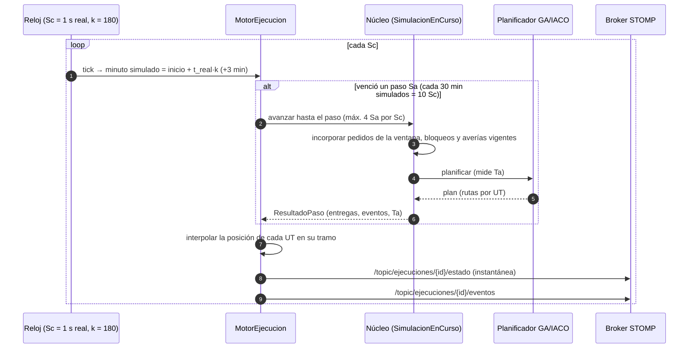
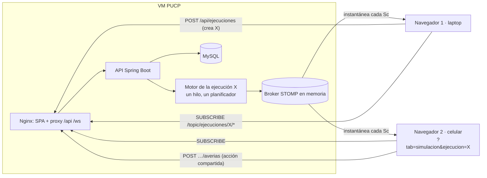

# Reporte de autoevaluación – PaqTracker (Equipo 2B) – 2026-11-07

Rúbrica: hoja `91.EvaSw` (AutoEVAL.REGISTRO.xlsx). Revisión hecha sobre `main` (`dbd8045`) **leyendo el código**,
sin modificarlo. Se ejecutó la batería de pruebas de rúbrica del front:
`npx vitest run src/test/rubrica` → **6 archivos, 96 pruebas pasan**, sin ningún `it.fails` pendiente (las 9
brechas de `docs/encargo-brechas-rubrica.md` ya están cerradas). No se levantó la API ni se probó en la VM.

> **Ojo con el dominio.** La rúbrica es genérica (aviones, aeropuertos). En PaqTracker: **UT** = autos, motos y
> bicicletas; **almacenes principales** = Central (27,14, stock ilimitado) + Intermedio 1 y 2 (tope 1000);
> **envío** = pedido; **producto** = paquete del producto único P (no tienen ID individual).
> Rutas del front relativas a `paqtracker-web/src/`.

## Actualización · 07-11-2026 · rama `feature/rubrica-equipo4` (v0.6.0)

Se implementaron las fases 0–4 de [`docs/plan-rubrica-equipo4.md`](docs/plan-rubrica-equipo4.md). Estado
**después** de esos cambios (las tablas de detalle de más abajo conservan la revisión original):

| Equipo | Ítems | ✅ | 🟡 | ❌ | 📝 | ❓ |
|---|---|---|---|---|---|---|
| 3 (solo Sí3) | 106 | 77 | 5 | 0 | 20 | 4 |
| **4 (Sí3 + Sí4) ← equipo** | **114** | **85** | **5** | **0** | **20** | **4** |
| 5 (todo) | 122 | 88 | 5 | 5 | 20 | 4 |

| Ítem | Antes | Ahora | Evidencia |
|---|---|---|---|
| A01 | 🟡 | ✅ | `v0.6.0 · <commit>` en `components/layout/FooterBar.tsx` (inyectado en `vite.config.ts`); CHANGELOG 0.6.0 |
| A22, A23 | 📝 | ✅ | [`docs/diagramas.md`](docs/diagramas.md) |
| E18, E19 | 🟡 | ✅ | Pestaña **Almacenes**: `components/operacion/ListaAlmacenes.tsx`; prueba `rubrica.envios.test.tsx` |
| E20, E21, E22 | 🟡 ❌ ❌ | ✅ | Detalle del almacén: En camino · Por salir 4 h · Entregados 4 h (`EnviosAlmacen`); fracciones en `SeguimientoPedidos.java`; selectores `lib/envios.ts` |
| E31 | 🟡 | ✅ | Pestaña **Pedidos** (`ListaPedidos.tsx`): destino, cantidad, ruta, unidades, salida y llegada por fracción; cola con columnas Salida y Unidades |
| E32, E33 (Sí5) | ❌ | ✅ | Filtros "Entregados · 4 h" y "Por entregar · 4 h" en la pestaña Pedidos |
| F01, F05 | 🟡 | ✅ | Selección compartida: `hooks/useNavegacionPanel.ts`, `accionAlElegirEnMapa` |
| F02 | 🟡 | ✅ | Fracción seleccionable (resalta solo su ruta): `unidadesResaltadas`, `FilaFraccion.tsx` |
| G08, G10 | 🟡 | ✅ | `GET /api/ejecuciones/{id}/plan-estable` + pestaña "Última planificación estable" del informe (`ReportePlanificacion.tsx`) |
| G09 | ❌ | ✅ | "Generar reporte de cierre" en Resumen del día a día (`DialogoReporteCierre.tsx`), sin detener la operación |

Quedan en 🟡 **B02, B04, B07, B08, B09** (configuración del dominio, fase 5, pendiente de la respuesta del
profesor) y en ❓ lo que se verifica en la VM (A20, A21, C03, C04). Del nivel 5 faltan E08, E09, E11, E16 y E17
(km).

## Resumen (revisión original)

- **Tamaño de equipo considerado:** `N_INTEGRANTES = 4`. Para un equipo de 4 son obligatorios los ítems Sí3 y
  Sí4. El equipo también piensa cubrir los Sí5, pero como objetivo secundario: van aparte, como opcionales.
- **Obligatorio para 4 integrantes (114 ítems):** ✅ Cumple 70 · 🟡 Parcial 15 · ❌ Falta 3 · 📝 Doc 22 · ❓ No verificable 4
- **Opcional Sí5 (8 ítems):** ✅ 1 (B05) · ❌ 7 (E08, E09, E11, E16, E17, E32, E33)

| Si el equipo es de… | Ítems | ✅ | 🟡 | ❌ | 📝 | ❓ |
|---|---|---|---|---|---|---|
| 3 (solo Sí3) | 106 | 64 | 13 | 3 | 22 | 4 |
| **4 (Sí3 + Sí4) ← equipo** | **114** | **70** | **15** | **3** | **22** | **4** |
| 5 (todo) | 122 | 71 | 15 | 10 | 22 | 4 |

Los 7 ❌ adicionales del nivel 5 son todos de distancia en km y de ventanas de 4 h en la lista de envíos
(E08, E09, E11, E16, E17, E32, E33).

En el nivel 4 (Sí4), lo que queda pendiente es **E31** (lista de envíos: falta la hora de salida y la lista en
Simulación) y **F02** (seleccionar un producto). Los demás Sí4 (D07, E06, E07, E14, E15, F03) ya cumplen.

**Top 5 faltantes de mayor impacto (entrega SW, equipo de 4):**
1. **E21 / E22** – En el almacén no hay envíos *por salir en las próximas 4 h* ni *entregados en las últimas 4 h*.
2. **G08 / G09 / G10** – El "Informe de la corrida" da indicadores, pero no **la última planificación estable**
   (rutas y asignaciones). En Operación día a día no hay ningún reporte de cierre.
3. **E18 / E19 / F05** – No hay **lista de almacenes** en el panel; solo el detalle de uno por vez. El indicador
   global "Almacenes" no abre nada: `onAbrirAlmacenes` existe en `GridMap` pero nadie lo pasa.
4. **B02 / B04 / B07–B09** – Ubicación y capacidad de almacenes, capacidad/velocidad de UT y duraciones de
   averías son **constantes del código**. Solo se puede elegir la cantidad de UT, la unidad y el tipo de avería.
5. **E31 / F02 (Sí4)** – A la lista de envíos le falta la hora de salida y la ruta, y en Simulación no hay lista
   de envíos. Seleccionar un "producto" no es posible porque los paquetes no tienen identificador.

También importan los puntos **B02 / B04 / B07–B09** (los valores del dominio son constantes; esfuerzo L) y
**A22 / A23** (no hay diagramas en el repo; abajo se proponen en Mermaid).

---

## Detalle por sección

### A. General

| Ítem | Nivel | Estado | Evidencia | Qué falta / Recomendación |
|---|---|---|---|---|
| A01 | Sí3 | 🟡 | `CHANGELOG.md` (última versión 0.5.0 del 18-09; lo posterior está en "[Sin publicar]"); `paqtracker-web/package.json:4` = `0.0.0` | No se ve la versión en la app ni hay tags de git. Publicar la versión en el CHANGELOG, poner un tag y mostrar `vX.Y.Z` en `FooterBar.tsx`. |
| A02 | Sí3 | 📝 | — | Administrativo. |
| A03 | Sí3 | 📝 | `PENDIENTES.md`, `docs/verificacion-evaluacion.md` §5 (dudas para el profesor) | Llevar esas dudas como "problemas reportados". |
| A04 | Sí3 | ✅ | GA: `paqtracker-planificador-nucleo/.../planificador/PlanificadorGA.java` | — |
| A05 | Sí3 | 📝 | GA integrado en la API y por defecto (`application.yml`: `PLANIFICADOR_ALGORITMO:GA`) | Estimación: ~100 %. |
| A06 | Sí3 | 📝 | No figura en el repo | Completar los nombres. |
| A07 | Sí3 | ✅ | IACO: `.../planificador/PlanificadorIACO.java`; comparación en `docs/comparacion_ga_iaco.md` | — |
| A08 | Sí3 | 📝 | IACO se puede elegir con `PLANIFICADOR_ALGORITMO=IACO` y tiene banco de experimentos | Estimación: ~100 % (es el algoritmo alterno). |
| A09 | Sí3 | 📝 | No figura | Completar. |
| A10 | Sí3 | ✅ | GA (`FabricaAlgoritmo.java`); justificación en `docs/Justificacion_tecnica_GA_PaqTracker.docx` | — |
| A11 | Sí3 | 📝 | Ciclo completo: incorpora, planifica, despacha, replanifica tras avería o pedido nuevo y detecta colapso | Estimación: 90–95 %. |
| A12 | Sí3 | 📝 | No figura | Completar. |
| A13 | Sí3 | ✅ | React 18 + TypeScript + Vite 8 + Tailwind 3; mapa **SVG propio** sin teselas (`components/map/GridMap.tsx`); STOMP/WebSocket (`services/clienteStomp.ts`) | — |
| A14 | Sí3 | 📝 | 96 pruebas de rúbrica en verde | Estimación: 85–90 % (faltan los puntos de abajo). |
| A15 | Sí3 | 📝 | No figura | Completar. |
| A16 | Sí3 | 📝 | — | Administrativo. |
| A17 | Sí3 | ✅ | Se mide en cada planificación: `ResultadoPaso.tiempoComputoMs` → `IndicadoresOperacion.tiempoComputoUltimoTaMs` y se muestra en `InformeCorrida.tsx:114` | No hay tope de tiempo: Ta depende de GA 50 individuos × 70 generaciones (`PlanificadorGA.java:29,36`). Medir el valor real en la VM antes de exponer. |
| A18 | Sí3 | ✅ | `application.yml:44-45` `sa-minutos: 30` (`PLANIFICADOR_SA_MINUTOS`) | — |
| A19 | Sí3 | ✅ | `application.yml:42-43` `sc-segundos: 1`; k = 180 (`factor-periodo`/`factor-colapso`) | 1 Sc = 1 s real = 3 min simulados; 1 Sa = 10 Sc. |
| A20 | Sí3 | ❓ | `paqtracker-infra/` (Nginx sirve la SPA, `scripts/desplegar.sh`, `DESPLIEGUE-VM-PUCP.md`) | Está preparado. Confirmar en la VM con los `curl` de la sección 7 de esa guía. |
| A21 | Sí3 | ❓ | `systemd/paqtracker-api.service`, `-Xmx640m` | Igual que A20 (`/api/ejecuciones` → 200, `/ws` → 101). |
| A22 | Sí3 | 📝 | Solo texto: `paqtracker-api/README.md` ("Cómo funciona una ejecución") | **Falta el diagrama.** Propuesta abajo. |
| A23 | Sí3 | 📝 | Tópicos STOMP por ejecución (`PublicadorStomp.java:15-33`) | **Falta el diagrama.** Propuesta abajo. |

### B. Configuración

| Ítem | Nivel | Estado | Evidencia | Qué falta / Recomendación |
|---|---|---|---|---|
| B01 | Sí3 | ✅ 📝 | Malla de 70 × 50 km: `ConfiguracionDominio.java:15-18` y `config/dominio.ts:6-7`; se encuadra sola (prueba C3) | Es una constante: hay que explicarlo así. |
| B02 | Sí3 | 🟡 | `ConfiguracionDominio.java:41,130-132` (literales); solo `GET /api/configuracion/dominio` | No se pueden editar ni guardar. Tabla `almacen` (V7), `PUT /api/configuracion/almacenes` y una pantalla. Esfuerzo **L** (ver `docs/verificacion-evaluacion.md` §4.1). |
| B04 | Sí3 | 🟡 | Cantidad por tipo desde la UI (`ConfiguracionEscenario.tsx`, máx. 50); capacidad/velocidad/costo fijos (`TipoVehiculo.java:23-27`) | Hacer editables capacidad y velocidad (M). |
| B05 | Sí5 | ✅ | `POST /api/archivos/bloqueos` (`ControladorPedidos.java:106`), validación línea por línea | Solo por archivo, sin alta manual de un bloqueo (valor agregado opcional). |
| B06 | Sí3 | ✅ | `GET/PUT /api/configuracion/semaforo`, tabla `rangos_semaforo` (V6), `components/map/DialogoRangosSemaforo.tsx` | Otras pestañas abiertas toman los rangos nuevos al recargar. |
| B07 | Sí3 | 🟡 | El usuario elige unidad y tipo (`DialogoRegistrarAveria.tsx`); 120 min y 30 min de trasvase son constantes (`ConfiguracionDominio.java:96,114`) | El instante es siempre "ahora" y las duraciones no se editan. |
| B08 | Sí3 | 🟡 | 240 min en el sitio + fin del turno siguiente (`Averia.java:88-95`, `CalendarioTurnos.java:56`) | Igual que B07. |
| B09 | Sí3 | 🟡 | 2 días + turno de las 15:00 (`ConfiguracionDominio.java:108`, `CalendarioTurnos.java:67`) | Igual que B07; `mant.preventivo.*.txt` no se carga en la API. |
| B13 | Sí3 | ✅ | Subida desde la GUI (`ConfiguracionEscenario.tsx`) → `AlmacenArchivosLocal` guarda `ventas.AAAAMM.txt` / `bloqueo.AAMM.txt`; MySQL guarda ejecuciones, pedidos en vivo, averías y rangos | Explicar: los datos masivos van en archivos por mes; el RDBMS guarda el estado operativo. |
| B14 | Sí3 | 📝 ✅ | `IntegracionApiTest` (2026-01-01, 2026-01-31 cruce de mes, 2030-01-01 sin datos), `rubrica.simulacion.test.tsx` (2026-03-03), CPA v03 (2027–2030) | Llevar la lista. |
| B15 | Sí3 | ✅ | Solo se filtra por ventana de tiempo (`CargadorDatosEscenario.java:59-60,85-87`) | Los escenarios del experimento GA vs IACO son sintéticos: aclararlo si preguntan. |
| B16 | Sí3 | ✅ | El archivo subido queda en la carpeta de datos y lo usa cualquier ejecución, también el día a día (`CargadorDatosEscenario.java:61`) | En la UI, la subida solo está dentro de Simulación. Conviene un acceso propio. |

### C. Mapa base

| Ítem | Nivel | Estado | Evidencia | Qué falta / Recomendación |
|---|---|---|---|---|
| C02 | Sí3 | ✅ | Fecha + "Hora de inicio" en `ConfiguracionEscenario.tsx` (prueba `C1 · pide también la hora…`) | — |
| C03 | Sí3 | ❓ | — | Medir con cronómetro en la VM (desde "Iniciar" hasta que se ve el mapa). |
| C04 | Sí3 | ❓ | La primera difusión llega al primer Sc (1 s), después del primer Ta | Medir en la VM. |
| C05 | Sí3 | ✅ | La corrida queda en la URL `?tab=simulacion&ejecucion=<id>` (`ModuloSimulacion.tsx:10-15`) y aparece en la lista de corridas "En curso" | — |
| C06 | Sí3 | ✅ | Cada navegador se suscribe a `/topic/ejecuciones/{id}/…` (`useEstadoEjecucion.ts:54`); selección, zoom, filtros y paneles son estado local | Pausa y averías van por la API y afectan a todos: así lo prevé la rúbrica. |
| C07 | Sí3 | ✅ | Toda la UI en español | Hacer un repaso visual (PENDIENTES.md menciona mezcla "corrida"/"simulación", que es terminología, no idioma). |
| C08 | Sí3 | ✅ | Zoom continuo con la rueda (`GridMap.tsx:274-296`); prueba `C08` | — |
| C09 | Sí3 | ✅ | Prueba `C2 · el mapa … es la pantalla principal` | — |
| C10 | Sí3 | ✅ | Prueba `C3 · la malla se encuadra al tamaño disponible` | — |
| C11 | Sí3 | ✅ | Prueba `C4 · al inicio … panel lateral y capas y leyenda cerrados` | — |
| C12 | Sí3 | ✅ | `EncabezadoCorrida.tsx`; prueba `C35` | — |
| C13 | Sí3 | ✅ | Prueba `C37` (incluye segundos) | — |
| C14 | Sí3 | ✅ | "Fecha y hora real"; prueba `C36` | — |
| C15 | Sí3 | ✅ | Prueba `C38` | — |
| C16 | Sí3 | ✅ | Prueba `C16 · los tiempos van en dos pares…` | — |
| C17 | Sí3 | ✅ | Pruebas `C5`, `C12` | — |
| C18 | Sí3 | ✅ | Símbolos en `components/map/simbolos.tsx` | Confirmar a ojo. |
| C19 | Sí3 | ✅ | Ícono propio de almacén (prueba `C6`) | — |
| C20 | Sí3 | ✅ | Pruebas `C6`, `C13` | — |
| C21 | Sí3 | ✅ | Prueba `C15` (semáforo + vacío) | El central no tiene tope: se explica. |
| C22 | Sí3 | ✅ | Prueba `C14`: % fijo en el mapa y en el tooltip | — |
| C23 | Sí3 | ✅ | Prueba `C23` | — |
| C24 | Sí3 | ✅ | `components/map/iconosVehiculo.ts` | Confirmar a ojo. |
| C25 | Sí3 | ✅ | Ícono por tipo (auto, moto, bicicleta) | — |
| C26 | Sí3 | ✅ | Prueba `C24` (contraste ≥ 3:1) | — |
| C27 | Sí3 | ✅ | Prueba `C29` (vacío, verde, ámbar, rojo) | — |
| C28 | Sí3 | ✅ | Prueba `C28` (número en el mapa, % en el tooltip) | — |
| C29 | Sí3 | ✅ | Interpolación en `hooks/useDeslizamientoUnidades.ts`; prueba `C27` (cuadros de 100 ms sin saltos) | Confirmar en la VM con varias UT. |
| C30 | Sí3 | ✅ | `GridMap.tsx:832-834` (`scale(-1,1)` / `rotate(±90)`); prueba `C26` | — |
| C31 | Sí3 | ✅ | Prueba `C30` | — |
| C33 | Sí3 | ✅ | Prueba `C31` (2–4 px, más gruesa si está seleccionada) | — |
| C34 | Sí3 | ✅ | `dividirRuta` (`GridMap.tsx:809`): lo recorrido en gris sólido, lo pendiente punteado; prueba `C34` | — |

### D. Circunstancias

Todo cumple. El detalle de contrastes está en `docs/verificacion-evaluacion.md` ("Bloque D") y en
`test/rubrica/rubrica.bloque-d.test.tsx`.

| Ítem | Nivel | Estado | Evidencia |
|---|---|---|---|
| D01 | Sí3 | ✅ | Capa de bloqueos en `GridMap.tsx` (~1058) |
| D02 | Sí3 | ✅ | Magenta #BE185D, fuera del semáforo (prueba D2) |
| D03 | Sí3 | ✅ | 4,06:1 sobre el fondo y 3,56:1 sobre la malla (prueba D3) |
| D04 | Sí3 | ✅ | Solo se envían los vigentes: `ConstructorInstantanea.java:175-189`; `MotorEjecucionTest.java:229` |
| D05 | Sí3 | ✅ | `FiltrosMapa.tsx:96`; prueba `D05` |
| D06 | Sí3 | ✅ | `FiltrosMapa.tsx:110`; prueba `D06` |
| D07 | Sí4 | ✅ | `FiltrosMapa.tsx:114`; prueba `D07` |
| D10 | Sí3 | ✅ | Número + forma + color por tipo (`simbolos.tsx`); prueba `D10` |
| D11 | Sí3 | ✅ | Azul celeste, ciruela y marrón (`iconosVehiculo.ts`) |
| D12 | Sí3 | ✅ | ≥ 4,8:1 sobre el fondo y la malla |
| D13 | Sí3 | ✅ | Anillo de progreso y hora de regreso; prueba `D13` |

### E. Panel

| Ítem | Nivel | Estado | Evidencia | Qué falta / Recomendación |
|---|---|---|---|---|
| E01 | Sí3 | ✅ | Panel lateral cerrado al inicio; barra de pestañas a la derecha (`BarraPaneles.tsx`) | — |
| E02 | Sí3 | ✅ | Pestaña Flota → "Todas las unidades" con `carga/capacidad · %` (`EstadoFlota.tsx:270-290`) | — |
| E03 | Sí3 | ✅ | `MarcaSemaforo` + `nivelDeOcupacion`; prueba `E02–E03` | — |
| E04 | Sí3 | ✅ | Detalle de la UT → paradas = pedidos que lleva (`PanelLateral.tsx` `Paradas`); prueba `C73` | — |
| E05 | Sí3 | ✅ | Paquetes por parada; prueba `E05` | Los paquetes no tienen ID (producto único P): explicarlo. |
| E06 | Sí4 | ✅ | "Minutos" + referencia "Llegada" (`lib/listaUnidades.ts:56`); prueba `E06` | — |
| E07 | Sí4 | ✅ | Referencia "Salida"; prueba `E07` | — |
| E08 | Sí5 | ❌ | — | Buscar por km al destino (con la malla Manhattan, `km = Σ` de la ruta restante). S. |
| E09 | Sí5 | ❌ | — | Ídem, por km al origen. S. |
| E11 | Sí5 | ❌ | — | Filtro permanente por rangos [0,10[, [10,20[, [20,40[, [40,200[ km, que se combine con la búsqueda. S. |
| E13 | Sí3 | ✅ | `ordenarUnidades` (`lib/listaUnidades.ts:42`); prueba `E13` | — |
| E14 | Sí4 | ✅ | Prueba `E14–E15` | — |
| E15 | Sí4 | ✅ | Prueba `E14–E15` | — |
| E16 | Sí5 | ❌ | Criterios actuales: CODIGO, OCUPACION, SALIDA, LLEGADA | Agregar "km por recorrer". S. |
| E17 | Sí5 | ❌ | — | Agregar "km recorridos" (el backend debe enviar la distancia acumulada o la ruta completa). M. |
| E18 | Sí3 | 🟡 | Stock en número y % en `DetalleAlmacen` (`PanelLateral.tsx:417`), un almacén a la vez | **No hay lista de almacenes.** Agregar una sección o pestaña "Almacenes" con los 3 y conectarla a `onAbrirAlmacenes`. S. |
| E19 | Sí3 | 🟡 | Semáforo + vacío en el detalle | Igual que E18. |
| E20 | Sí3 | 🟡 | "Unidades que salieron de aquí" con carga y paradas (`PanelLateral.tsx:434,473`) | Hay que entrar UT por UT. Agregar la lista de **envíos/paquetes en tránsito** desde ese almacén (se puede derivar de `flota[].paradas`). S. |
| E21 | Sí3 | ❌ | — | **Envíos por salir en las próximas 4 h.** La instantánea no trae el plan de las UT que siguen en el almacén. Hace falta la hora de salida planificada en `UnidadEnMapa`, o un endpoint. M. |
| E22 | Sí3 | ❌ | `PedidoEnMapa` no trae ni hora de entrega ni almacén de origen | **Envíos entregados en las últimas 4 h.** Agregar `entregaMs` y `almacenOrigen` a `PedidoEnMapa` (o un endpoint de hitos) y filtrar en el front. M. |
| E31 | Sí4 | 🟡 | Cola de pedidos: destino, cantidad, vehículo, llegada estimada (`ColaPedidos.tsx:167`). El detalle muestra todas las UT si el pedido va fraccionado | Falta la **hora de salida** y la ruta en la lista. En Simulación no hay lista de envíos, solo "pedidos en riesgo". M. |
| E32 | Sí5 | ❌ | Hay filtro por estado "Entregado", pero sin ventana de tiempo | Filtro "entregados en las últimas 4 h" (depende de E22). S tras E22. |
| E33 | Sí5 | ❌ | — | Filtro "a entregar en las próximas 4 h" (con `etaMs`/`horaLimiteMs`). S. |

### F. Vinculación mapa ↔ panel

| Ítem | Nivel | Estado | Evidencia | Qué falta / Recomendación |
|---|---|---|---|---|
| F01 | Sí3 | 🟡 | Lista → mapa: halo y ruta destacada (`GridMap.tsx:880-932`). Mapa → panel: abre el **detalle** de la UT (prueba `C50`) | Al elegir en el mapa, la fila de la lista no se resalta, porque el detalle reemplaza a la lista. Dejar la lista visible con la fila marcada y `scrollIntoView` (ya existe `data-unidad`). S. |
| F02 | Sí4 | 🟡 | Seleccionar un pedido resalta su ruta | No se puede elegir un **producto**: los paquetes no tienen identidad. Explicarlo, o tratar "fracción del pedido en la UT X" como producto. |
| F03 | Sí4 | ✅ | Pedido fraccionado → se resaltan todas sus rutas (`unidadesDestacadas`, prueba `C67`) | — |
| F05 | Sí3 | 🟡 | Mapa → panel abre el detalle (pruebas `C48`, `C49`); detalle → "Centrar en el mapa" (`C52`, `C53`) | Sin lista de almacenes no hay "seleccionar en la lista" (ver E18). |

### G. Cierre

| Ítem | Nivel | Estado | Evidencia | Qué falta / Recomendación |
|---|---|---|---|---|
| G01 | Sí3 | ✅ | `components/map/IndicadoresGlobales.tsx`; prueba `G01–G02` | — |
| G02 | Sí3 | ✅ | Ídem | — |
| G03 | Sí3 | ✅ | Prueba `G03–G04` | El indicador no abre nada (`onAbrirAlmacenes` sin conectar). |
| G04 | Sí3 | ✅ | Ídem | — |
| G05 | Sí3 | ✅ | `TIEMPO_SERVICIO_MINUTOS = 60` (`ConfiguracionDominio.java:21`) → `Orquestador` (`tiempoServicio`) | — |
| G06 | Sí3 | ✅ | Un motor por ejecución con su propio hilo; N suscriptores STOMP; enlace por URL | Probarlo en vivo con laptop + celular antes de la exposición. |
| G07 | Sí3 | 📝 ✅ | `util/Malla.java:22-36`: se conocen de antemano y se rodean según el instante en que la UT pasa por el tramo | Ver la respuesta sugerida abajo. |
| G08 | Sí3 | 🟡 | `InformeCorrida.tsx`: resultado, Ta, indicadores, parámetros y exportación CSV | Es un resumen, no **la planificación** (rutas por UT, pedidos asignados, horas). Agregar la sección "Última planificación estable" con la tabla UT → secuencia de pedidos → salida/llegada. M. |
| G09 | Sí3 | ❌ | Operación día a día: solo hay exportación CSV de la bitácora (`BitacoraEventos.tsx:21`) | Agregar "Cerrar operación / Generar reporte" que reutilice el informe de G08. M. |
| G10 | Sí3 | 🟡 | El informe marca el instante del colapso (prueba `C79`); `DiagnosticoColapso.tsx` | Igual que G08. El diagnóstico usa una heurística del front (`PENDIENTES.md`). |
| G11 | Sí3 | 📝 | — | Ver "Percepción global". |
| G12 | Sí3 | 📝 | — | Ídem. |
| G13 | Sí3 | 📝 | — | Ídem. |
| G14 | Sí3 | 📝 | — | Ídem. |
| G17 | Sí3 | 📝 | — | Ídem. |
| G18 | Sí3 | 📝 | — | Ídem. |
| G19 | Sí3 | 📝 | — | Opinión. |

**Fuera de este ciclo, pero ya implementado (valor agregado):** leyenda de los colores de las rutas, filtro de
la lista de UT por estado (en ruta, disponible, averiada), apertura y centrado de la UT desde la lista de averías
(prueba `C54`), cancelación de averías (`DELETE …/averias/{id}`) y buscador de pedidos, UT y almacenes en el mapa.

---

## Pendientes priorizados

### Obligatorio para el equipo de 4 (Sí3 + Sí4)

| # | Ítem(s) | Nivel | Descripción | Esfuerzo | Archivos |
|---|---|---|---|---|---|
| 1 | E18, E19, F05, G03 | Sí3 | Lista de almacenes (stock n/%, semáforo + vacío, clic → detalle + centrar) y conectar `onAbrirAlmacenes` | S | `operacion/PanelLateral.tsx` o un componente nuevo, `types/operacion.ts` (`PestanaPanel`), `BarraPaneles.tsx`, `ModuloOperacion.tsx`, `CorridaSimulacion.tsx` |
| 2 | F01 | Sí3 | Al elegir la UT en el mapa, resaltar su fila en la lista y hacer scroll | S | `operacion/EstadoFlota.tsx`, `PanelLateral.tsx` |
| 3 | E20 | Sí3 | En el detalle del almacén, listar los envíos/paquetes en tránsito (de `flota[].paradas`) | S | `PanelLateral.tsx` (`DetalleAlmacen`) |
| 4 | E22 | Sí3 | Entregados en las últimas 4 h por almacén. Hacerlo **junto con E32 (Sí5)**: usan el mismo dato nuevo `entregaMs` | M | `difusion/.../PedidoEnMapa.java`, `ConstructorInstantanea.java`, `services/adaptadorOperacion.ts`, `DetalleAlmacen` |
| 5 | E21 | Sí3 | Por salir en las próximas 4 h. Hacerlo **junto con E33 (Sí5)**: misma ventana de tiempo | M | `UnidadEnMapa.java` (salida planificada), `ConstructorInstantanea.java`, `DetalleAlmacen` |
| 6 | E31 | Sí4 | Lista de envíos con destino, ruta, UT(s), cantidad, hora de salida y de llegada (todas las UT si va fraccionado), disponible también en Simulación | M | `pedidos/ColaPedidos.tsx`, `simulacion/CorridaSimulacion.tsx`, `PedidoEnMapa.java` (hora de salida por UT) |
| 7 | F02 | Sí4 | Definir "producto" = la porción del pedido que lleva cada UT. Al elegirla en la lista de envíos, resaltar solo la ruta de esa UT (`unidadesDestacadas` con un solo código) | S | `GridMap.tsx`, `PanelLateral.tsx` (`DetallePedido`) |
| 8 | G08, G09, G10 | Sí3 | Informe con la última planificación estable (tabla por UT) en los 3 escenarios; cierre del día a día | M | `simulacion/InformeCorrida.tsx`, `operacion/ModuloOperacion.tsx`, quizá `GET /api/ejecuciones/{id}/plan` |
| 9 | A22, A23 | Sí3 | Llevar los diagramas Mermaid de abajo a `docs/` | S | `docs/diagramas.md` |
| 10 | A01 | Sí3 | Versión visible en la app + tag | S | `package.json`, `FooterBar.tsx`, `CHANGELOG.md` |
| 11 | B07–B09 | Sí3 | Elegir el instante de la avería (a), y si el profesor lo pide, editar las duraciones (b) | M / L | `SolicitudRegistroAveria.java`, `MotorEjecucion.programarAveria`, `DialogoRegistrarAveria.tsx` |
| 12 | B02, B04 | Sí3 | Editar almacenes y atributos de UT | L | ver `docs/verificacion-evaluacion.md` §4 |
| 13 | C03, C04, A20, A21, G06 | — | Medir y verificar en la VM con 2 dispositivos | S | — |

### Opcional (Sí5), después de lo anterior

| # | Ítem(s) | Descripción | Esfuerzo | Archivos |
|---|---|---|---|---|
| 14 | E32, E33 | Filtros de envíos entregados en las últimas 4 h y a entregar en las próximas 4 h. Son casi gratis si se hacen junto con los puntos 4 y 5 | S | `pedidos/ColaPedidos.tsx` |
| 15 | E08, E09, E16 | Buscar y ordenar por km al destino y al origen, y por km por recorrer. Se calculan en el front con `rutaRestante` (Manhattan) | S | `lib/listaUnidades.ts`, `EstadoFlota.tsx` |
| 16 | E11 | Filtro permanente por rangos [0,10[, [10,20[, [20,40[, [40,200[ km, combinable con la búsqueda | S | `EstadoFlota.tsx`, `lib/listaUnidades.ts` |
| 17 | E17 | Ordenar por km recorridos: el backend debe enviar la distancia acumulada del recorrido | M | `UnidadEnMapa.java`, `ConstructorInstantanea.java`, `lib/listaUnidades.ts` |

**Orden sugerido:** 1–3 y 7 (rápidos, solo front) → 4–5 junto con 14 → 6 → 8 → 9–10 → 15–16 → 11–12 y 17.

---

## Respuestas sugeridas para la exposición

### A17–A19 · Ta, Sa, Sc
- **Ta** se mide en cada planificación (`ResultadoPaso.tiempoComputoMs`). Se ve como "Tiempo de la última
  planificación" en el informe y viaja en cada instantánea (`tiempoComputoUltimoTaMs`). GA usa 50 individuos ×
  70 generaciones; no hay corte por tiempo. *Llevar el valor medido en la VM.*
- **Sa** = 30 min simulados (`PLANIFICADOR_SA_MINUTOS`). Un pedido registrado a mano en el día a día replanifica
  en el acto, sin esperar el Sa.
- **Sc** = 1 s real (`APP_SC_SEGUNDOS`). Con k = 180, cada Sc avanza 3 min simulados; 1 Sa = 10 Sc; 5 días
  simulados ≈ 40 min reales. Si el planificador se atrasa, hace hasta `APP_MAX_PASOS_POR_TICK = 4` pasos Sa por Sc.

### A22 · Consumo de datos en bloques Sc dentro de cada Sa

### A23 · Varios navegadores en la simulación del periodo

- Hay **un solo planificador por ejecución**. Cada navegador recibe la misma instantánea y mantiene su propio
  zoom, filtros, selección y paneles (C06).
- Las acciones que cambian la ejecución (avería, pausa) van por REST y se reflejan en todos.

### B · Cómo se configura cada cosa
- **B01 Mapa:** malla fija de 70 × 50 km, en el núcleo y en el front; se encuadra al tamaño de la pantalla.
- **B02 Almacenes:** constantes en `ConfiguracionDominio` (Central 27,14 ilimitado; intermedios 12,38 y 57,27 con
  1000). Hoy no se editan.
- **B04 UT:** la cantidad por tipo se fija al crear la simulación (hasta 50 por tipo). Capacidad, velocidad y
  costo/km son constantes de `TipoVehiculo`.
- **B05 Bloqueos:** se sube `bloqueo.AAMM.txt` desde la GUI; se valida línea por línea y se guarda por mes.
- **B06 Semáforo:** "Capas y leyenda → Configurar rangos". Se valida, se guarda en `rangos_semaforo` y rige al
  instante. El vacío es configurable.
- **B07–B09 Averías:** el operador elige la unidad y el tipo; el sistema estima la reincorporación antes de
  confirmar. Duraciones: T1 2 h + 30 min de trasvase; T2 4 h en el sitio y luego al central hasta el fin del
  turno siguiente; T3 4 h en el sitio y vuelve al turno de las 15:00 cumplidos 2 días.
- **B13:** `ventas.AAAAMM.txt` y `bloqueo.AAMM.txt` se suben por la interfaz y quedan en la carpeta de datos.
  MySQL guarda el estado operativo.
- **B14:** ver la evidencia de B14 en la tabla.
- **B15:** no se descarta ningún registro, solo se filtra por la ventana de la ejecución.
- **B16:** los datos subidos quedan disponibles para cualquier escenario, incluido el día a día.

### G07 · Bloqueos en el planificador
Los bloqueos se conocen de antemano, con su ventana y su polilínea. `Malla` precalcula los instantes en que
cambia el conjunto de nodos bloqueados. Al evaluar una ruta, cada tramo usa los bloqueos **vigentes en el
instante en que la UT pasa por él**: rodea uno que empieza a mitad del viaje y aprovecha uno que termina antes.
No dependen del salto de datos. El mapa muestra solo los vigentes en el minuto simulado; con Sc = 1 s y k = 180,
el desfase visual máximo es de 3 min simulados.

### Percepción global (G11–G18) – opinión fundamentada
- **Completo / al día (G11):** el mapa, los tiempos, el bloque D, la lista de UT y los indicadores globales
  están completos y con pruebas automáticas. Faltan las listas de almacén por ventana de 4 h, la lista de
  almacenes y el reporte de la planificación.
- **Apropiado (G12) / claro (G13):** hay un design system propio, contrastes medidos (WCAG / ΔE00) y una sola
  terminología del dominio.
- **Factible en el plazo (G14):** los pendientes 1–3, 7 y 8 son de un día. Los 4–6 piden cambios chicos en
  backend y front. B02/B04 es lo único grande.
- **Fortalezas (G17):** arquitectura modular (núcleo / API / web); 3 escenarios a la vez con un motor por
  ejecución; 96 pruebas de rúbrica en el front y pruebas de integración en la API; dos metaheurísticas
  comparadas; despliegue documentado para una VM de 2 GB.
- **A mejorar (G18):** que se pueda configurar el dominio (almacenes, UT, averías); que el reporte sea la
  planificación y no solo KPI; diagramas de arquitectura en el repo; versión visible en la app.
