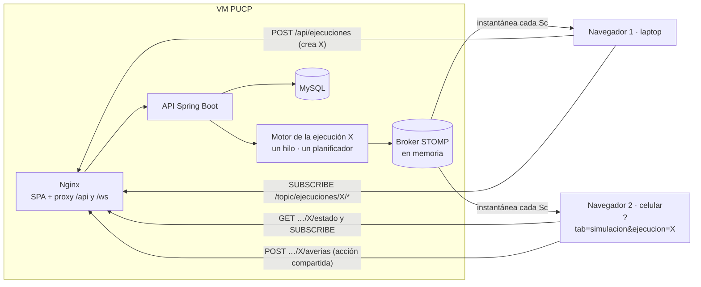
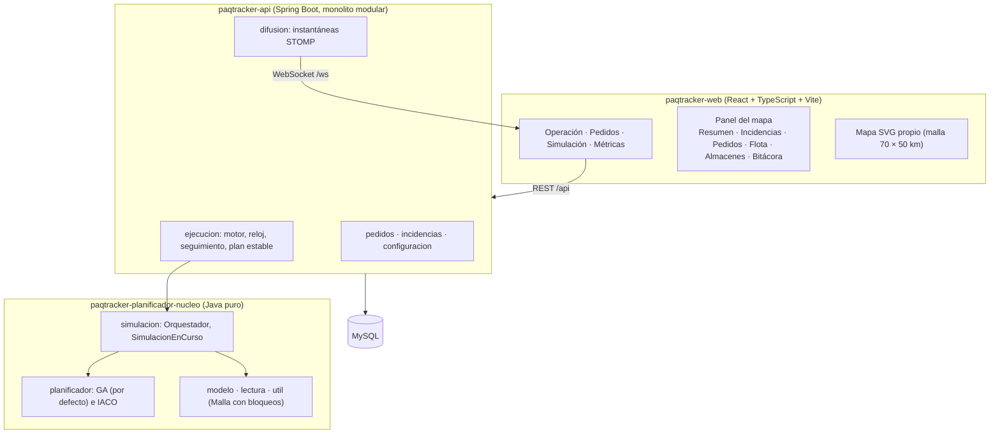

# Diagramas de PaqTracker

Respaldo de los ítems A22 y A23 de la rúbrica 91.EvaSw y vista de componentes para la exposición. Los valores
salen de `paqtracker-api/src/main/resources/application.yml`: **Sc = 1 s real**, **Sa = 30 min simulados**,
**k = 180** (5 días simulados ≈ 40 min reales).

## 1. Consumo de datos en bloques Sc por cada bloque Sa (A22)

Con k = 180, cada Sc avanza 3 min simulados; un Sa (30 min) son 10 Sc. El planificador corre solo en los Sc en
que vence un Sa; en los demás, el motor interpola las posiciones y difunde la instantánea. Si el planificador
se atrasa, se ejecutan hasta `APP_MAX_PASOS_POR_TICK = 4` pasos Sa en un mismo Sc.

```mermaid
sequenceDiagram
    autonumber
    participant R as Reloj (Sc = 1 s real, k = 180)
    participant M as MotorEjecucion
    participant N as Núcleo (SimulacionEnCurso)
    participant P as Planificador GA / IACO
    participant S as SeguimientoPedidos
    participant B as Broker STOMP
    loop cada Sc
        R->>M: tick: minuto simulado = inicio + t_real × k (+3 min)
        M->>M: aplica averías agendadas (paso inmediato, sin planificar)
        alt venció un paso Sa (cada 30 min simulados = 10 Sc)
            M->>N: avanzar(instante del Sa)
            N->>N: incorpora pedidos de la ventana; bloqueos y averías vigentes
            N->>P: planificar la cola (mide Ta)
            P-->>N: rutas por unidad
            N-->>M: ResultadoPaso (despachos, entregas, Ta)
            M->>S: aplicar(paso): estados, fracciones, hitos
            M->>M: guarda la última planificación estable (memento)
        end
        M->>B: /topic/ejecuciones/{id}/estado (instantánea completa)
        M->>B: /topic/ejecuciones/{id}/eventos (eventos del paso)
    end
```

## 2. Varios navegadores durante la simulación del periodo (A23)

Hay **un solo motor (y un solo planificador) por ejecución**. Cada navegador se suscribe a los tópicos de esa
ejecución y recibe la misma instantánea; el zoom, los filtros, la selección y los paneles son estado local de
cada navegador (C06). Las acciones que cambian la ejecución (avería, pausa, detener) van por REST y todos ven
su efecto en la instantánea siguiente.



Un navegador que entra tarde pide primero `GET /api/ejecuciones/{id}/estado` (la última instantánea) y luego se
suscribe; así no espera al siguiente Sc para ver el mapa (C05).

## 3. Componentes


