# Plan de trabajo: rúbrica 91.EvaSw para un equipo de 4

**Base:** [`REPORTE_AUTOEVAL.md`](../REPORTE_AUTOEVAL.md) (revisión del 07-11-2026 sobre `main` `dbd8045`).
**Meta:** cerrar todos los ítems Sí3 + Sí4 que hoy están 🟡 o ❌, dejando el diseño listo para los Sí5 sin rehacer
nada. Las rutas del front son relativas a `paqtracker-web/src/`; las del back, a `paqtracker-api/.../modulos/`.

---

## 0. Qué hay que cerrar

| Bloque | Ítems | Hoy | Fase |
|---|---|---|---|
| Modelo de envíos (datos) | base de E20–E22, E31, F02 | — | 1 |
| Lista de almacenes | E18, E19, F05, (G03: el indicador no abre nada) | 🟡 | 2 |
| Selección compartida mapa ↔ lista | F01, F05 | 🟡 | 2 |
| Almacén: en tránsito / por salir 4 h / entregados 4 h | E20, E21, E22 | 🟡 ❌ ❌ | 2 |
| Lista de envíos en el panel | E31 (Sí4) | 🟡 | 3 |
| Seleccionar un "producto" | F02 (Sí4) | 🟡 | 3 |
| Reporte de la última planificación estable | G08, G09, G10 | 🟡 ❌ 🟡 | 4 |
| Configuración del dominio | B02, B04, B07, B08, B09 | 🟡 | 5 |
| Documentación y versión | A01, A22, A23 | 🟡 📝 | 0 (en paralelo) |
| Verificación en la VM | A20, A21, C03, C04, G06 | ❓ | 6 |

---

## 1. Decisiones de diseño (aplican a todo el plan)

### 1.1 Vocabulario: un solo nombre por concepto

La rúbrica habla de *envíos* y *productos*. En la interfaz **no** se introducen esos términos: se usa el
vocabulario que el operador ya conoce y se documenta la equivalencia para la exposición.

| Rúbrica | En la interfaz | Definición | Dónde vive |
|---|---|---|---|
| Envío | **Pedido** | Lo que pide un cliente: destino, cantidad, plazo | ya existe |
| Producto (con ID) | **Fracción** del pedido | Parte de un pedido que lleva **una** unidad. ID visible `#1088·1`, `#1088·2` | nuevo |
| Producto (unidad física) | **Paquete** | Unidad del producto P; no tiene identidad propia | ya existe |
| UT | **Unidad** (auto, moto, bicicleta) | — | ya existe |

- Un pedido sin fraccionar tiene una sola fracción (`#1088·1`). En la interfaz, el sufijo `·1` se muestra solo
  cuando el pedido va fraccionado, para no meter ruido.
- Los términos nuevos van a `config/glosario.ts` (`NOMBRE_ESTADO_FRACCION`, `etiquetaFraccion()`,
  `VENTANA_RECIENTE`), igual que los demás.
- Se aprovecha el barrido de microcopy de `PENDIENTES.md`: se fija **"simulación"** (no "corrida") en los
  textos visibles. Los nombres de los componentes pueden quedarse como están.

### 1.2 Patrones de arquitectura

| Patrón | Dónde | Por qué |
|---|---|---|
| **Modelo de lectura (proyección)** | `SeguimientoPedidos` ya proyecta los `ResultadoPaso` en el estado de cada pedido. Se extiende con **fracciones** | Lo que el panel necesita se calcula una vez por paso y no en cada navegador; el núcleo no se toca |
| **Instantánea + eventos** | La instantánea STOMP sigue siendo la fuente de verdad del estado; los eventos alimentan la bitácora | Un navegador que se conecta tarde recibe todo por `GET …/estado` (C05) |
| **Memento** | `PlanEstable`: copia inmutable del plan después de cada planificación que terminó bien | El reporte G08–G10 no depende de que la ejecución siga viva |
| **Puertos y adaptadores** | `FuenteParametrosDominio` (igual que `FuenteRangosSemaforo`) | El núcleo recibe los parámetros; ni la base ni Spring entran al núcleo |
| **Objeto de valor** | `VentanaTiempo(desde, hasta)` en el back, `ventana(reloj, ±4 h)` en el front | La regla "últimas/próximas 4 h" se escribe una sola vez |
| **Selectores puros** | `lib/envios.ts`, `lib/almacenes.ts` (como `lib/listaUnidades.ts`) | Filtros, conteos y orden se prueban sin montar componentes y se memorizan con `useMemo` |
| **Estado de selección único** | `seleccion` sigue viviendo en `ModuloOperacion` / `CorridaSimulacion`; se separa *qué está seleccionado* de *qué muestra el panel* | Es lo que hace bidireccional a F01 y F05 |
| **Composición** | `PantallaMapa` (nuevo) agrupa `GridMap` + `PanelLateral` + `BarraPaneles`, que hoy se arman dos veces | Cada cambio de panel se hace una vez y vale para Operación y Simulación |

### 1.3 Principios de UX/UI (aplican a todo componente nuevo)

1. **Maestro–detalle sin perder el contexto.** Al elegir algo en el mapa no se pierde la lista: la fila se
   resalta y se lleva a la vista. El detalle se abre con un segundo gesto ("Ver detalle ›" o Enter).
2. **Revelado progresivo.** Las filas muestran 2 líneas (identidad + dato clave); el resto va al detalle.
   Los conteos de las subpestañas dicen cuánto hay antes de abrirlas.
3. **El color nunca es la única señal** (`docs/design-system.md` §Principios 4): semáforo = punto + texto
   ("Ocupación alta"). Lo mismo para las fracciones entregadas (✓) y liberadas por avería (↺).
4. **Tiempo relativo + absoluto juntos:** "sale 14:20 · en 35 min", "entregado 09:05 · hace 2 h 10 min".
   Formato de 24 h. Las ventanas se calculan siempre con el **reloj simulado** de la ejecución, no con el real.
5. **Estados vacíos que explican:** decir qué no hay y por qué, nunca un "Sin datos" a secas (ver 1.4).
6. **Estabilidad visual a 1 Sc:** la instantánea llega cada segundo. Las listas no deben saltar: claves
   estables (`codigo`), orden estable en empates, sin animación de reordenamiento, y el scroll no se mueve
   salvo cuando el usuario selecciona.
7. **Teclado y lector de pantalla:** las listas seleccionables usan `role="listbox"` + `aria-selected` (o
   `aria-current`), ↑/↓ para moverse, Enter abre el detalle y Esc vuelve (ya existe `useCerrarConEscape`).
   `scrollIntoView({ block: 'nearest', behavior: reducedMotion ? 'auto' : 'smooth' })`.
8. **Tokens, no hex.** Los componentes nuevos usan las clases de token (`text-neutral-500`, `bg-primary-50`…)
   de `tailwind.config.js`. No se migran los existentes en este plan.

### 1.4 Guía de microcopy

| Situación | Texto | Evitar |
|---|---|---|
| Subpestañas del almacén | "En camino (3)", "Por salir · 4 h (5)", "Entregados · 4 h (8)" | "Tránsito", "Outbound" |
| Vacío, por salir | "Ninguna unidad sale de este almacén en las próximas 4 h." | "Sin datos" |
| Vacío, entregados | "Nada entregado desde este almacén en las últimas 4 h (desde las 10:20)." | "No hay registros" |
| Central | "Sin tope · abastece a toda la red" | "∞", "Ilimitado" solo |
| Fracción | "Fracción 2 de 3 · 12 paquetes en Moto M-04" | "Producto 2" |
| Pedido fraccionado | "Va en 3 unidades" | "Split" |
| Reporte | "Reporte de la planificación" · subtítulo "Última planificación estable: 14:30 (simulado)" | "Informe del plan" |
| Botón de cierre del día a día | "Generar reporte de cierre" + "No detiene la operación." | "Cerrar operaciones" (suena a apagar) |
| Validación de configuración | "La ubicación (72, 10) está fuera de la malla de 70 × 50." | "Valor inválido" |
| Cambio que aplica después | "Se aplica a las simulaciones que crees desde ahora. La operación en curso no cambia." | — |

Reglas: oraciones cortas, en segunda persona solo en instrucciones, sin jerga técnica (Sa, Sc, k solo en el
reporte y en Parámetros), números con `formatearMiles`, unidades siempre explícitas (paquetes, km, min).

---

## 2. Fases

Esfuerzo: **S** ≤ 1 día · **M** 2–3 días · **L** ≥ 4 días (persona).

### Fase 0 · Documentación y versión (A01, A22, A23) · S · en paralelo

- `docs/diagramas.md` con los dos Mermaid del reporte (consumo Sa/Sc y varios navegadores), más un
  diagrama de componentes (núcleo / API / web / VM) para G17.
- **A01:** publicar `0.6.0` en `CHANGELOG.md`, `git tag v0.6.0`, `package.json` → `0.6.0`. Inyectar la
  versión en el build (`define: { __VERSION__: JSON.stringify(pkg.version) }` en `vite.config.ts`) y mostrar
  `v0.6.0 · <commit corto>` en `FooterBar.tsx`. La API la expone en `GET /api/configuracion/dominio`
  (`version`) para comprobar que front y back coinciden.
- **Aceptación:** la versión se ve en el pie de página; los diagramas se ven en GitHub.

### Fase 1 · Modelo de fracciones (base de E20–E22, E31, F02) · M · back

**Idea:** cada pedido lleva la lista de sus fracciones; con eso salen todas las vistas del panel sin pedir
nada más al núcleo.

1. **DTO nuevo** `difusion/aplicacion/dto/FraccionEnvio.java`:
   ```java
   record FraccionEnvio(String codigo,        // "#1088·2"
                        String unidad,        // "M-04"
                        String almacenOrigen, // CENTRAL | INTERMEDIO_1 | INTERMEDIO_2
                        int cantidad,         // paquetes
                        long salidaMs,        // puede ser futura: la ruta ya se despachó pero aún no sale
                        long llegadaMs,       // estimada; real si ya se entregó
                        String estado)        // PROGRAMADA | EN_CAMINO | ENTREGADA | LIBERADA
   ```
   - `PROGRAMADA` = `salida > ahora`. Es posible porque `UnidadEnTransito` acepta una salida futura
     (`UnidadEnTransito.java:137`).
   - `LIBERADA` = devuelta a la cola por una avería; se conserva para la trazabilidad.
2. **`SeguimientoPedidos.Seguimiento`**: reemplazar `unidad` / `eta` / `partesEnCamino` por
   `List<Fraccion> fracciones`, y mantener `unidad` y `eta` como valores derivados para no romper la API.
   Puntos de actualización:
   - `registrarSalida` (fracción nueva con su salida y su origen);
   - `registrarLlegada` (ENTREGADA, `llegada` = real);
   - `retirarParte` (LIBERADA);
   - trasvase (LIBERADA en la averiada + fracción nueva en la que la recibe).
3. **`PedidoEnMapa`** y **`RespuestaPedido`**: agregar `List<FraccionEnvio> fracciones`, `Long entregaMs` y
   `Long salidaMs` (la primera salida).
4. **Instantánea:** agregar `List<PedidoEnMapa> entregadosRecientes` a `MensajeEstadoEjecucion`, con los
   pedidos cuya `entregaMs` cae en `[ahora − 4 h, ahora]`.
   - Está acotado: con ~170 pedidos/día (ventas 2028) son unas 30 filas.
   - La ventana sale de `paqtracker.panel.ventana-horas: ${APP_VENTANA_PANEL_HORAS:4}`, para no fijar el 4.
   - No se mezclan con `pedidos`, para no alterar los conteos que ya usan el front y las pruebas.
5. **Front:** `types/api.ts`, `services/adaptadorOperacion.ts` → `PedidoOperacion.fracciones: Fraccion[]`,
   `DatosOperacion.entregadosRecientes`.
6. **Pruebas:**
   - `SeguimientoPedidosTest`: fraccionado en 2 unidades; avería con trasvase; salida futura → PROGRAMADA;
     entrega → ENTREGADA con hora real.
   - `ConstructorInstantaneaTest`: la ventana incluye su borde (−4 h) y excluye lo anterior.
   - `adaptadorOperacion.test.ts`.

> Riesgo: el tamaño de la instantánea. Hay que medir los bytes antes y después con el escenario de colapso;
> si crece más de 30 %, enviar `fracciones` solo en `GET /api/pedidos/{codigo}` y en la instantánea dejar
> `(unidad, almacenOrigen, salidaMs, estado)`.

### Fase 2 · Almacenes en el panel + selección compartida (E18–E22, F01, F05, G03) · M · front

**2a. Pestaña "Almacenes"** (`components/operacion/ListaAlmacenes.tsx`)
- Nueva pestaña en `BarraPaneles` (ícono `Warehouse` de lucide), entre Flota y Bitácora. Se suma a
  `PestanaPanel`, `SubvistaOperacion` y `SUBVISTAS_VALIDAS` (la URL la recuerda: `?panel=almacenes`).
- Una fila por almacén:
  - nombre y tipo;
  - `MarcaSemaforo` + "Ocupación alta";
  - `stock/capacidad · %` con su barra (el central: "Sin tope");
  - aviso de stock bajo;
  - tres contadores compactos: `↗ 3 en camino · ⏱ 5 por salir · ✓ 8 entregados`.
- Conectar el indicador global: `onAbrirAlmacenes={() => seleccionar({ tipo: 'almacenes' })}` en las dos
  pantallas (G03), y `onAbrirFlota` a la pestaña Flota (hoy cae en `onAbrirAverias`).
- Selectores en `lib/almacenes.ts`:
  - `enCamino(almacen, datos)` = fracciones EN_CAMINO con ese origen;
  - `porSalir(almacen, datos, reloj, 4 h)` = PROGRAMADA con `salida ∈ (ahora, ahora+4 h]`;
  - `entregadosRecientes(almacen, datos, reloj, 4 h)`.

**2b. Detalle del almacén** (`DetalleAlmacen` en `PanelLateral.tsx`)
- Debajo del stock, subpestañas con su conteo: **En camino · Por salir (4 h) · Entregados (4 h)**. Se reusa
  el componente `Subpestanas` que ya existe.
- Fila: `#1088·2 · 12 paquetes · Moto M-04 · sale 14:20 (en 35 min) → (34, 20)`. Un clic selecciona la
  fracción (fase 3) y resalta su ruta en el mapa. "Ver unidad ›" abre la unidad.
- Se conserva "Unidades que salieron de aquí": deja de ser la única forma de ver el tránsito (E20).

**2c. Selección compartida (F01, F05)**
- Se separan dos ideas que hoy son una sola:
  - `seleccion`: qué objeto está elegido (resalta en el mapa y en la lista);
  - `vista del panel`: qué pestaña o qué detalle se ve.
- Reglas de interacción:
  | Gesto | Panel cerrado | Panel en una lista (Flota / Almacenes) | Panel en un detalle |
  |---|---|---|---|
  | Clic en una unidad o almacén del mapa | abre el detalle (como hoy, sigue valiendo la prueba C50) | **resalta la fila y la lleva a la vista**; la lista se queda | cambia el detalle al nuevo objeto |
  | Clic en una fila | — | selecciona: halo en el mapa + centra si está fuera de la vista | — |
  | Enter o "Ver detalle ›" en la fila seleccionada | — | abre el detalle | — |
  | "‹ Flota" / "‹ Almacenes" (migas) o Esc en el detalle | — | — | vuelve a la lista **con la misma fila resaltada** |
- Implementación:
  - fila con `aria-selected`, clase `bg-primary-50 ring-1 ring-primary-600`, `data-unidad` / `data-almacen`
    (el primero ya existe);
  - hook `useResaltarEnLista(ref, codigo)` que hace el `scrollIntoView`;
  - el encabezado del detalle muestra migas con el origen ("Flota › A-01") en vez del "Volver" genérico.
- **Pruebas** (`test/rubrica/rubrica.panel.test.tsx`, numeración 91.EvaSw):
  - `E18–E19`: la lista con stock, % y semáforo + vacío;
  - `E20`, `E21`, `E22`: las ventanas con un reloj fijo; los bordes de 4 h entran o no;
  - `F01`: clic en el mapa con la Flota abierta → la fila tiene `aria-selected=true` y la lista sigue visible;
  - `F05`: lo mismo con almacenes;
  - `G03`: el indicador "Almacenes" abre la pestaña.

### Fase 3 · Pedidos en el panel + fracción seleccionable (E31, F02) · M · front (+ back de la fase 1)

**3a. Pestaña "Pedidos" del panel** (`components/operacion/ListaEnvios.tsx`), en Operación y en Simulación.
- Hoy la Simulación no tiene lista de pedidos.
- La tabla grande del módulo Pedidos (`ColaPedidos.tsx`) se queda; esta es la versión compacta junto al mapa.
- Fila de 2 líneas:
  - línea 1: `#1088 · → (34, 20) · 20 paquetes` + semáforo de holgura;
  - línea 2: `Central → A-01 · sale 10:00 · llega 11:20` o, si va fraccionado, `Va en 2 unidades · llega 11:20–12:05`.
- La fila se expande (acordeón, `aria-expanded`) y muestra cada fracción con:
  - unidad;
  - almacén de origen;
  - paquetes;
  - salida y llegada;
  - estado (✓ entregada, ↗ en camino, ⏱ programada, ↺ liberada);
  - "Ver ruta".
  Eso es "todas las rutas y horarios" de E31.
- Búsqueda por código o unidad. Orden: hora límite (por defecto), llegada, salida.
- Chips de filtro: **Todos · En camino · En espera**.
  - Dejar el lugar para los chips Sí5 ("Entregados · últimas 4 h", "Por entregar · próximas 4 h"): con la
    fase 1, E32 y E33 son ~2 h más.
- `ColaPedidos.tsx`: agregar las columnas "Salida" y "Unidades" (todas, no solo la primera) y su CSV.

**3b. La fracción como selección (F02)**
- `SeleccionPanel` suma `{ tipo: 'fraccion'; pedido: string; unidad: string }`.
- En `GridMap`, `unidadesDestacadas` para una fracción = `{ unidad }`. Se resalta **solo esa ruta** y el
  pin del destino. El pedido completo sigue resaltando todas sus rutas: **F03 sigue cumpliendo**.
- Puntos de entrada:
  - fila de fracción en la lista de pedidos;
  - "Vehículos asignados" del detalle del pedido (`PanelLateral.tsx`, `DetallePedido`);
  - subpestañas del almacén.
- **Pruebas:**
  - `E31`: un pedido fraccionado muestra las 2 fracciones con su salida y su llegada;
  - `F02`: al elegir `#1001·2` se destaca solo la ruta de M-01;
  - `F03` sin cambios.

### Fase 4 · Reporte de la última planificación estable (G08, G09, G10) · M · back + front

**4a. Back**
- **Definición:** la *última planificación estable* es el plan vigente después de la última planificación
  que **terminó** (`ResultadoPaso.huboPlanificacion()`) y no declaró colapso
  (`!paso.isColapsoDeclarado()`). En el colapso, el reporte usa el plan anterior al paso que colapsó y lo dice.
- `PlanEstable` (record inmutable, guardado en `MotorEjecucion`):
  - `instanteMs`, `taMs`, `fitness`, `algoritmo`;
  - por unidad: código, tipo, almacén, salida, regreso estimado, km, carga/capacidad, y paradas
    (pedido·fracción, destino, paquetes, llegada estimada, hora límite, holgura);
  - pedidos en cola sin asignar.
  - Se arma con `SimulacionEnCurso.getUnidadesEnTransito()` justo después del paso.
- `GET /api/ejecuciones/{id}/plan-estable` (200; 404 si todavía no hubo plan). Vale para las 3 ejecuciones.
- **Prueba:** `MotorEjecucionTest`. Después del primer Sa existe el plan; en el colapso, el plan es el del
  paso anterior.

**4b. Front** (`components/reporte/ReportePlanificacion.tsx`, compartido)
- **Encabezado:**
  - escenario;
  - "Última planificación estable: 04/03 14:30 (simulado)";
  - Ta, algoritmo, Sa/Sc/k.
- **Resumen:** unidades usadas / total, paquetes planificados, km, pedidos sin asignar.
- **Tabla por unidad**, con acordeón de paradas en orden.
- Botones: **Exportar CSV**, **Imprimir** (con `@media print` y sin los controles).
- **Dónde aparece:**
  - **Simulación de periodo (G08):** nueva pestaña "Planificación" dentro de `InformeCorrida`, junto a
    "Resumen". Se abre sola al terminar.
  - **Colapso (G10):** la misma pestaña, con un aviso arriba: "El plan es el anterior al colapso de las 05/03
    02:10. Pedido que lo causó: #2231." Usa la causa real de la API: así se cierra también el pendiente
    de `PENDIENTES.md` sobre la heurística del diagnóstico.
  - **Operación día a día (G09):** botón **"Generar reporte de cierre"** en la barra superior de Operación.
    Abre el reporte en un diálogo de pantalla completa con la nota "No detiene la operación". Si el
    profesor pide un cierre real, se agrega el reporte automático a las 23:59, cuando se repone el stock.
- **Pruebas:** `rubrica.simulacion.test.tsx` → `G08`, `G09`, `G10` (el reporte lista unidades con sus
  paradas; en el colapso aparece el aviso).

### Fase 5 · Configuración del dominio (B02, B04, B07–B09) · L · back + núcleo + front

> **Hecha (07-11-2026).** Diferencias con el diseño de abajo: una sola tabla `parametros_dominio` con el JSON
> en lugar de tres (V7), endpoint único `/api/configuracion/parametros`, y "Aplicar a la operación" como
> `POST /api/ejecuciones/dia-a-dia/reiniciar`. Los almacenes siguen siendo tres (central + dos intermedios);
> se editan su ubicación y su capacidad. Los turnos no son configurables.

Es lo más costoso: conviene confirmar el alcance con el profesor antes (ver §5). Diseño:

- **Patrón:** *configuración versionada por ejecución*. Los parámetros se editan en una pantalla, se guardan
  en la base y **cada ejecución nueva copia la versión vigente al crearse**, igual que hoy pasa con la flota.
  - Una ejecución en curso nunca cambia a mitad de camino: es reproducible y no hay estados raros.
  - El día a día toma los cambios al reiniciar o con "Aplicar a la operación". Esa acción pide confirmación
    y avisa que se replanifica.
- **Núcleo:**
  - `ParametrosDominio` (record) con almacenes, tipos de unidad y averías;
  - `ConfiguracionDominio.porDefecto()` devuelve los valores actuales;
  - `Averia`, `GestorTrasbordo`, `TipoVehiculo` (capacidad y velocidad) y `crearAlmacenes()` reciben
    los parámetros en vez de leer constantes estáticas;
  - la experimentación sigue con `porDefecto()`, así que no se rompe nada.
- **API:**
  - migraciones V7 (`almacen_config`), V8 (`tipo_unidad_config`) y V9 (`averia_config`), con `DEFAULT`
    = los valores actuales;
  - `GET/PUT /api/configuracion/{almacenes|tipos-unidad|averias}` con validación de dominio:
    - nodo dentro de 70 × 50;
    - nodos sin repetir;
    - exactamente 1 central;
    - capacidades > 0;
    - duraciones > 0;
    - el tipo 3 ≥ el tipo 2 en el sitio.
  - `FuenteParametrosDominio` en `FabricaMotorEjecucion`.
- **Front:**
  - nuevo módulo de primer nivel **Configuración** (5.ª pestaña de `App.tsx`) con 4 secciones:
    Almacenes, Unidades, Averías y Semáforo (este último ya existe; se mueve aquí y se deja un acceso
    en la leyenda);
  - formularios en línea con validación al salir del campo, el error junto al campo (1.4) y una vista
    previa de la ubicación en un minimapa (`MiniMapaMalla.tsx` ya existe);
  - "Restablecer valores por defecto" con confirmación;
  - el front deja de duplicar `config/dominio.ts`: lee `GET /api/configuracion/dominio` al arrancar.
- **B07–B09, parte (a), alcance mínimo seguro:** elegir el **instante** de la avería (ahora o una hora
  futura del reloj simulado) en `DialogoRegistrarAveria`.
  - API: campo opcional `instante` en `SolicitudRegistroAveria`; la validación va en
    `MotorEjecucion.programarAveria` (≥ ahora, dentro del horizonte).
  - Las averías programadas se listan en Incidencias y se pueden cancelar.
- **Pruebas:**
  - `ParametrosDominioTest` (validaciones);
  - integración de los PUT;
  - `OrquestadorTest` con una duración del tipo 1 distinta (se aplica);
  - front: un formulario por sección.

### Fase 6 · Verificación en vivo (A20, A21, C03, C04, G06) · S

- Desplegar en la VM con `paqtracker-infra/scripts/desplegar.sh` y correr los `curl` de
  `DESPLIEGUE-VM-PUCP.md` §7.
- Medir con cronómetro, 3 veces cada uno y tomar la mediana:
  - "Iniciar" → mapa visible (C03);
  - "Iniciar" → primer movimiento (C04);
  - Ta en el reporte (A17).
  Anotar los valores en el reporte.
- Prueba con 2 dispositivos (laptop + celular):
  - abrir la misma simulación por enlace;
  - cada uno con su zoom, filtros y selección;
  - registrar una avería desde el celular y comprobar que la laptop la recibe (C05, C06, G06).
- Repetir con las capacidades nuevas (fases 2–4) y revisar la memoria (`free -h` < 800 MB).

---

## 3. Calidad transversal (definición de terminado de cada fase)

- [ ] `npm run lint`, `npm test`, `npm run build` y `./mvnw verify` en verde; CI (`java.yml`, `web.yml`) pasa.
- [ ] Cada ítem de la rúbrica tiene su prueba en `src/test/rubrica/` con el código 91.EvaSw en el nombre, como
      las que ya existen.
- [ ] Textos nuevos en `config/glosario.ts`, revisados contra la guía 1.4.
- [ ] Teclado: se llega a todo con Tab; las listas responden a ↑/↓/Enter/Esc; se ve el foco.
- [ ] Contraste ≥ 4,5:1 en texto y ≥ 3:1 en íconos (se verifica con `paleta.test.ts`).
- [ ] La instantánea se procesa en < 16 ms con 150 unidades (perfil de React DevTools). Los selectores van con
      `useMemo` y dependen de `datos`.
- [ ] Se probó también en Simulación, no solo en Operación (la composición única `PantallaMapa` lo facilita).
- [ ] Revisión visual a 1366 × 768 (laptop del laboratorio) y con el panel abierto.
- [ ] `REPORTE_AUTOEVAL.md` actualizado: el estado del ítem pasa a ✅ con la evidencia nueva.

---

## 4. Reparto sugerido (4 personas) y orden

| Persona | Fase(s) | Depende de |
|---|---|---|
| **P1 · Back** | 1 (fracciones + instantánea) → 4a (plan estable) → 5 back/núcleo | — |
| **P2 · Front panel** | 2 (almacenes + selección compartida) → 3 (pedidos + fracción) | fase 1 para 2b y 3; 2a y 2c pueden empezar ya |
| **P3 · Front reportes** | 0 (versión) → 4b (reporte) → 1.1/1.4 (barrido de microcopy) | 4a |
| **P4 · Config + infra** | 5 front (pantalla Configuración, avería programada) → 0 (diagramas) → 6 (VM) | 5 back de P1 |

```mermaid
gantt
    dateFormat  X
    axisFormat  día %s
    section Back
    F1 Fracciones e instantánea     :b1, 0, 3
    F4a Plan estable                :b2, after b1, 2
    F5 Núcleo y API configuración   :b3, after b2, 5
    section Front
    F2a/2c Lista almacenes y selección :f1, 0, 2
    F2b Subpestañas del almacén     :f2, after b1, 1
    F3 Pedidos y fracción           :f3, after f2, 3
    F0 Versión                      :f0, 0, 1
    F4b Reporte                     :f4, after b2, 3
    F5 Pantalla configuración       :f5, 3, 5
    section Cierre
    F6 Verificación en la VM        :v1, after f3, 1
```



Prioridad si falta tiempo: **2 → 1 → 3 → 4 → 0 → 6 → 5**. Las fases 2–4 cierran 9 ítems Sí3/Sí4 visibles
en la demo; la 5 es la más cara y la que más depende de lo que acepte el profesor.

---

## 5. Preguntas para el profesor (antes de la fase 5 y de G09)

1. ¿Aceptan *pedido* = envío y *fracción del pedido en una unidad* = producto (E31, F02), dado que los
   paquetes no tienen identidad?
2. G09: ¿"cerrar las operaciones día a día" significa detenerlas, o basta con un reporte de cierre a demanda
   (o diario, a las 23:59)?
3. B07–B09: ¿qué atributos debe poder fijar el usuario: solo unidad, tipo e instante, o también las
   duraciones (2 h, 4 h, 2 días) y el turno de reincorporación?
4. B02/B04: ¿basta con que los cambios apliquen a las ejecuciones nuevas (configuración versionada), o
   deben aplicar en caliente?

---

## 6. Después (Sí5), sin rehacer nada

El diseño deja listos los ganchos:

- **E32, E33:** dos chips más en `ListaEnvios`, con los mismos selectores de ventana de la fase 2.
- **E08, E09, E16:** km calculados en `lib/listaUnidades.ts` sobre `ruta` (Manhattan), con los criterios
  `KM_DESTINO` y `KM_ORIGEN`.
- **E11:** grupo de chips de rango en `EstadoFlota`, combinable con la búsqueda.
- **E17:** `UnidadOperacion.distanciaRecorridaKm` existe, pero el adaptador la deja fija en `0`
  (`services/adaptadorOperacion.ts:171`). Hay que agregar `distanciaRecorridaKm` a `UnidadEnMapa`: lo
  recorrido hasta la posición actual, que sale de los tramos de `UnidadEnTransito`. Después, el criterio de
  orden.
